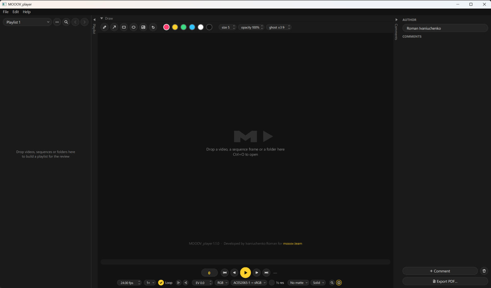

# MOOOV_player

A fast, quiet player for VFX review on Mac and Windows: videos and image sequences, EXR layers in ACES, drawing on frames, comments and PDF reports, all in one window.

Developed by Ivaniuchenko Roman for [mooov.team](https://mooov.team).



## What it does

**Playback**
- Videos (MOV, MP4, MXF, MKV, AVI, WebM …) and image sequences (EXR, PNG, JPG, TIFF, HDR, WebP).
- Open one frame and the whole sequence is picked up. Frames are read ahead in parallel and kept in RAM, so scrubbing and playback are instant after the first pass.
- Files on the network load in the background without freezing the window; switching a layer reloads only the frame under the playhead.
- Speed 0.25×–4×, loop, In / Out range, frame-accurate stepping, source frame numbers and timecode.

**EXR and colour**
- EXR layers (AOVs) and channels in one list, per layer; one-channel layers in grey.
- Views: sRGB, Linear and OCIO ACES 1.0 SDR — `ACEScg → sRGB`, `ACES2065-1 → sRGB`, `ACEScg → Rec.709`, `ACES2065-1 → Rec.709`, plus the views of your own `$OCIO` config.
- Info (Shift+I) reads the colour space from the EXR header, so you know which view to pick.
- Exposure, R / G / B / A / Luma, half resolution, mattes.

**Layers and compare**
- Stack clips as layers with blend modes, opacity, time offset and a rotatable split wipe.
- Edit mode: several clips one after another on one timeline. Playlists for a whole review session.

**Drawing and comments**
- Brush with pen pressure (Wacom, also with Windows Ink switched off), arrow, rectangle, ellipse, reference images.
- Press **+** to write a comment and draw into it; Enter finishes it. Drawing without **+** makes a separate "Sketch on frame" comment.
- Shift+drag pans, Ctrl+drag zooms, with any tool — handy with a pen.
- Comments are saved automatically next to the media in a small `.mooov.json` file.

**PDF report**
- One page per comment: number, frame, timecode, the text and the frame with the drawing; "Recorded with MOOOV_player <version> by <author>", date and file in the header.

## Install

**[Download page](https://ivanyuchenkoroman.github.io/MOOOV_player/)** — Mac and Windows, always the latest version. All files are also in [Releases](../../releases). Builds are made by GitHub Actions when a `v*` tag is pushed, or by hand from the Actions tab.

## Run from source

Needs [uv](https://docs.astral.sh/uv/).

```sh
uv sync
uv run python MOOOV_player.py [file]
```

To build the app yourself see [BUILD.md](BUILD.md). What changed in each version is in [RELEASE_NOTES.md](RELEASE_NOTES.md).
